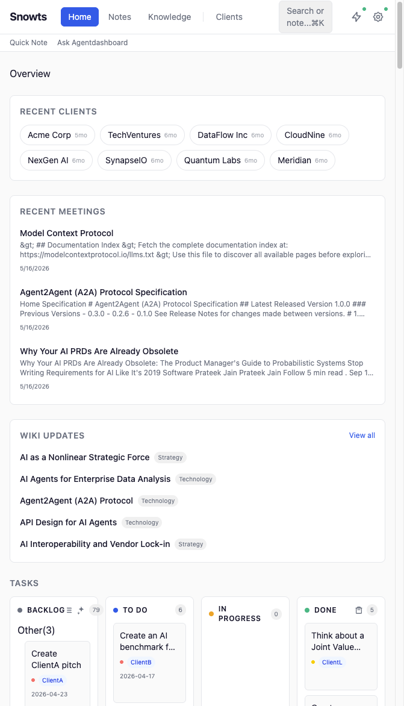
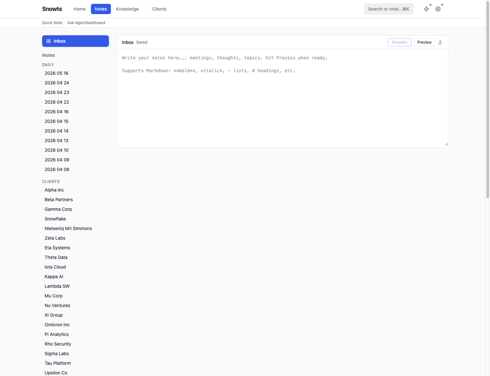
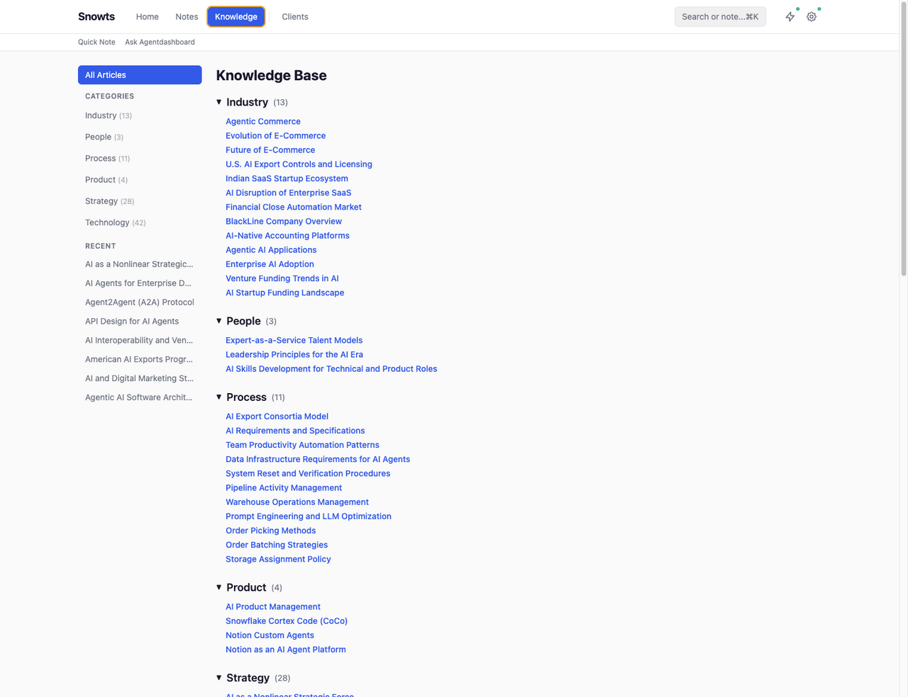
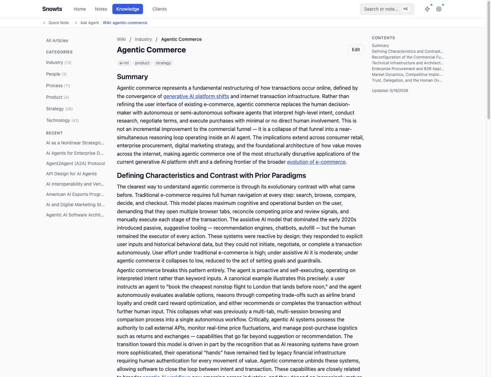
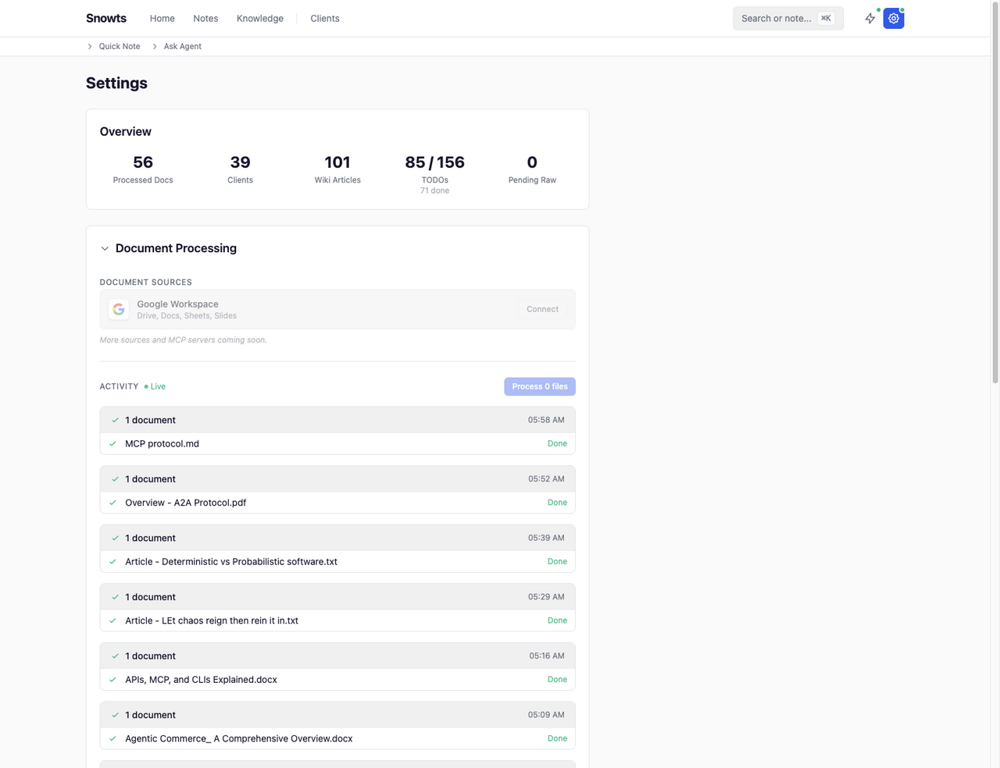

# Snowts

A personal knowledge management system built entirely on Snowflake. Snowts captures meeting notes, ingests documents, and uses Snowflake's native AI functions to automatically classify, extract, and organize everything into a searchable wiki — turning unstructured daily notes and files into structured, interconnected knowledge.

Inspired by Andrej Karpathy's [LLM-wiki concept](https://x.com/kaborojevic/status/1908912655361851626) — the idea that an LLM can continuously process raw information (notes, articles, documents) and maintain a living, evolving wiki of topics. Snowts implements this by routing every piece of input through Snowflake AI functions that classify content, extract entities, and merge insights into wiki articles that grow over time.

## Features

### Dashboard

A single-pane overview showing recent clients, meetings/documents, wiki updates, and AI-grouped tasks.



### Notes Inbox with Auto-Categorization

Write or paste meeting notes, thoughts, or raw text. Hit **Process** and the AI classifies each note — routing it to the right client folder, topic folder, or daily log. It extracts TODOs, client references, and key topics automatically.

The sidebar organizes notes by date, client, and topic — all auto-populated from AI classification.



### Knowledge Base (Wiki)

All processed content feeds into an auto-generated wiki organized by category (Industry, Strategy, Technology, Process, Product, People). Each article is a living document that grows as more related content is ingested.



Articles include cross-links to related topics, source attribution, tags, and a table of contents. The wiki merges new information into existing articles rather than creating duplicates.



### Document Processing Pipeline

Drop files (`.md`, `.txt`, `.html`, `.docx`, `.pdf`) and the pipeline runs:

1. Upload to Snowflake stage
2. `AI_PARSE_DOCUMENT` — extract text/OCR
3. `AI_CLASSIFY` — categorize by topic
4. `AI_EXTRACT` — pull structured entities (clients, contacts, dates, action items)
5. `AI_COMPLETE` — map content to wiki topics, fill gaps, generate summaries

Processing status streams in real-time via SSE. The Settings page shows the activity log.



### Quick Input & Agent

**Quick Note** (Cmd+K) — fast capture from anywhere in the app. Notes get processed and categorized inline.

**Ask Agent** — a Cortex Agent backed by semantic search across all wiki and article content, grounded in your knowledge base.

## Stack

- **Frontend:** React 18 (Vite 5) + TypeScript + TailwindCSS v4 + Zustand
- **Backend:** FastAPI + uvicorn
- **Database:** Snowflake (all persistent data lives in `SNOWTS_DB.APP`)
- **AI:** Snowflake AI Functions — `AI_COMPLETE`, `AI_CLASSIFY`, `AI_EXTRACT`, `AI_PARSE_DOCUMENT`
- **Search:** Cortex Search Service with incremental refresh
- **Agent:** Cortex Agent with semantic search tool
- **Local storage:** Markdown files for notes, local SQLite queue for offline operations

## How It Works

```
Notes / Documents
        │
        ▼
  ┌─────────────┐
  │  FastAPI     │──── SSE activity stream ────▶ Frontend
  │  Backend     │
  └──────┬──────┘
         │
         ▼
  ┌─────────────────────────────────────┐
  │          Snowflake                  │
  │                                     │
  │  Stage (RAW_DOCS)                   │
  │    │                                │
  │    ▼                                │
  │  AI_PARSE_DOCUMENT → AI_CLASSIFY    │
  │    → AI_EXTRACT → AI_COMPLETE       │
  │    │                                │
  │    ▼                                │
  │  Tables: ARTICLES, CLIENTS,         │
  │  WIKI_ARTICLES, TAGS, TODOS, ...    │
  │    │                                │
  │    ▼                                │
  │  Cortex Search Service              │
  │  Cortex Agent                       │
  └─────────────────────────────────────┘
```

## Fresh Install

### Prerequisites

- Python 3.11+
- Node.js 18+
- A Snowflake account with `ACCOUNTADMIN` (or equivalent privileges)
- Snow CLI installed (used for stage uploads)
- A connection configured in `~/.snowflake/connections.toml`

### 1. Backend

```bash
cd app/backend
pip install -r requirements.txt
```

### 2. Frontend

```bash
cd app/frontend
npm install
```

### 3. Snowflake Setup

Start the backend, open the app, navigate to **Settings**, and click **Run Setup**. This creates:

- Database `SNOWTS_DB` and schema `APP`
- Warehouse `SNOWTS_WH` (XS, auto-suspend 120s)
- All tables (ARTICLES, ARTICLE_CONTENT, CLIENTS, CLIENT_CONTACTS, TAGS, TODOS, WIKI_ARTICLES, etc.)
- Cortex Search Services (`SNOWTS_SEARCH_SERVICE`, `WIKI_SEARCH_SERVICE`)

### 4. Run

```bash
# Backend
SNOWFLAKE_CONNECTION_NAME=<your_connection> python3 -m uvicorn app.backend.main:app --reload --host 0.0.0.0 --port 8000 --app-dir /path/to/snowts

# Frontend
cd app/frontend && npm run dev
```

Frontend runs on `http://localhost:5173` and proxies `/api` calls to the backend on port 8000.

## Project Structure

```
snowts/
├── app/
│   ├── backend/
│   │   ├── main.py              # FastAPI app, status/dashboard endpoints
│   │   ├── db.py                # Snowflake connection, offline queue, helpers
│   │   ├── models/schemas.py    # Pydantic models
│   │   ├── routes/              # API routers (notes, pipeline, wiki, clients, todos, search, settings, activity)
│   │   └── services/
│   │       ├── ai.py            # AI_COMPLETE wrapper, classify_note, process_daily_note, annotate
│   │       ├── notes.py         # Note CRUD, inbox processing, section routing
│   │       ├── pipeline.py      # Document ingestion: stage upload → AI pipeline → table population
│   │       ├── wiki.py          # Wiki article management, content merging
│   │       ├── activity.py      # SSE event store, pub/sub for real-time streaming
│   │       ├── setup.py         # DDL definitions, setup, migration
│   │       └── shared.py        # Shared helpers (upsert_client, create_todo, parse_due_date)
│   └── frontend/
│       └── src/
│           ├── App.tsx           # Routes
│           ├── api/client.ts     # API client + SSE streaming
│           ├── components/       # Layout, QuickInput, CommandPalette, ActivityToolbar
│           ├── contexts/         # ActivityContext (SSE), AgentContext
│           ├── pages/            # Dashboard, Notes, Wiki, Clients, ClientDetail, Search, Settings
│           ├── store/index.ts    # Zustand store
│           └── types/index.ts    # TypeScript interfaces
├── notes/                        # Local markdown notes (daily/, clients/, topics/)
├── raw/                          # Drop zone for document ingestion pipeline
└── docs/screenshots/             # Feature screenshots
```

## Watchouts / Learnings

- **AI function syntax**: Use `AI_COMPLETE(...)`, `AI_CLASSIFY(...)`, etc. directly — no `SNOWFLAKE.CORTEX` namespace prefix.
- **Stage encryption**: Stages must use `SNOWFLAKE_SSE` encryption and `DIRECTORY = (ENABLE = TRUE)` for the pipeline to work.
- **TO_FILE arguments**: `TO_FILE('@db.schema.stage', 'filename')` — stage and filename are separate arguments, not a single path.
- **SQL parameters**: Snowflake connector uses `%s` placeholders (pyformat style).
- **Snow CLI path**: Resolved via `which snow`, the `SNOW_CLI` env var, or falls back to `/Applications/SnowflakeCLI.app/Contents/MacOS/snow`.
- **Connection management**: The backend reads `SNOWFLAKE_CONNECTION_NAME` env var at startup. You can also switch connections at runtime via the Settings UI.
- **Wiki merging**: The AI is prompted to merge new information into existing articles rather than creating duplicates, keeping the wiki from fragmenting.
